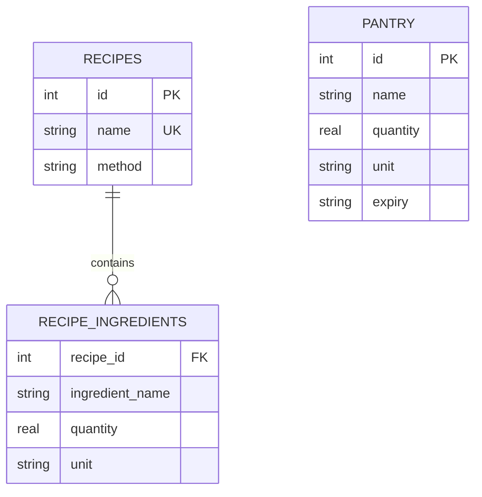

# Smart Pantry Manager — Database Design

## 1. Introduction

Smart Pantry Manager uses SQLite, a local relational database, to store pantry ingredients and recipe information on an Android device. The database supports pantry management and provides data used by the Suggested Recipes feature.

This document describes the database entities, their attributes, relationships, persistence, and testing approach.

## 2. Database Overview

- **Database name:** `smart_pantry.db`
- **Database technology:** SQLite
- **Database helper:** `DatabaseHelper.java`
- **Database version:** 2

The database contains three main tables:

1. `pantry` — stores ingredients recorded by the user.
2. `recipes` — stores recipe names and preparation instructions.
3. `recipe_ingredients` — stores the ingredient requirements associated with each recipe.

Application settings, including expiry reminders and low-stock alerts, are stored separately using Android SharedPreferences.

## 3. Table Design

### 3.1 Pantry Table

The `pantry` table stores the ingredients available to the user.

| Attribute | Description |
|---|---|
| `id` | Identifies a pantry record. |
| `name` | Ingredient name. |
| `quantity` | Amount of the ingredient available. |
| `unit` | Measurement unit, such as grams, kilograms, or pieces. |
| `expiry` | Expiry date recorded for the ingredient. |

**Purpose:** This table supports adding, viewing, editing, and deleting pantry ingredients.

### 3.2 Recipes Table

The `recipes` table stores the recipe collection.

| Attribute | Description |
|---|---|
| `id` | Identifies a recipe. |
| `name` | Recipe name; the database definition specifies this value as unique. |
| `method` | Recipe preparation instructions. |

**Purpose:** This table provides the recipe names and instructions displayed in the application.

### 3.3 Recipe Ingredients Table

The `recipe_ingredients` table stores the ingredients required by individual recipes.

| Attribute | Description |
|---|---|
| `recipe_id` | Associates an ingredient requirement with a recipe. |
| `ingredient_name` | Name of the ingredient required by the recipe. |
| `quantity` | Required quantity. |
| `unit` | Measurement unit for the required quantity. |

**Purpose:** This table allows a recipe to contain multiple ingredient requirements and provides information for recipe matching.

## 4. Entity-Relationship Design

The logical relationships between the tables are illustrated below.



The `recipes` and `recipe_ingredients` tables have a one-to-many logical relationship: a recipe can require multiple ingredients.

The pantry table records the user's available ingredients separately. Recipe matching compares those records with the requirements stored for each recipe.

**Note:** The diagram represents the logical design. Exact SQLite column types, constraints, foreign-key enforcement, and deletion behaviour should be confirmed against the table creation statements in `DatabaseHelper.java`.

## 5. Database Operations

### 5.1 Create

When a user adds a pantry ingredient, the application saves its details in the database.

### 5.2 Read

The application retrieves pantry records for display and retrieves recipes and their associated ingredient requirements for recipe suggestions and recipe details.

### 5.3 Update

When a user edits an ingredient, the application updates the stored pantry record.

### 5.4 Delete

When a user deletes an ingredient, the application removes the corresponding pantry record.

These operations provide the core Create, Read, Update, and Delete (CRUD) functionality.

## 6. Recipe Matching

The application uses the recipe collection and pantry records to determine which recipes can be suggested.

The matching process compares recipe ingredient requirements against ingredients recorded in the pantry. Required quantities and measurement units are relevant to determining whether enough of an ingredient is available.

The Suggested Recipes screen displays the results returned by the implemented matching logic. The exact rules for ingredient-name comparison, quantity conversion, and missing ingredients depend on the implementation in `DatabaseHelper.java`.

## 7. Data Persistence

SQLite stores pantry and recipe information locally on the device. This allows the application to retain saved database records when the user leaves a screen or closes and reopens the application.

Settings preferences are stored separately through Android SharedPreferences.

Persistence should be verified by saving pantry ingredients, closing and reopening the application, and checking that the saved records and settings remain available.

## 8. Database Initialisation and Versioning

The database is managed through `DatabaseHelper.java`. The current project uses database version 2 and includes recipe-seeding functionality.

Recipe initialisation makes the predefined recipe collection available to the application. Database creation and upgrade behaviour should be checked in the helper class to ensure that existing user data is handled appropriately when the schema changes.

## 9. Testing

The following tests can be performed manually:

1. Add a pantry ingredient and verify that it appears in the pantry.
2. Edit the ingredient and confirm that its updated details appear.
3. Delete the ingredient and verify that it no longer appears.
4. Close and reopen the application and check data persistence.
5. Open Suggested Recipes and verify that displayed suggestions correspond to the pantry contents and implemented matching rules.
6. Open a recipe and check that its ingredients and preparation instructions are displayed.
7. Change a setting, leave the Settings screen, return, and verify that the preference is retained.
8. Reset settings and verify that the default preferences are restored.

The project also includes JUnit unit tests for ingredient input validation. Run them from the project root on Windows with:

```powershell
.\gradlew.bat test
```

## 10. Conclusion

The database design supports the main data requirements of Smart Pantry Manager. SQLite stores pantry ingredients and recipe information, while SharedPreferences stores application settings. Together, these storage mechanisms support pantry management, recipe suggestions, and persistent user preferences.
